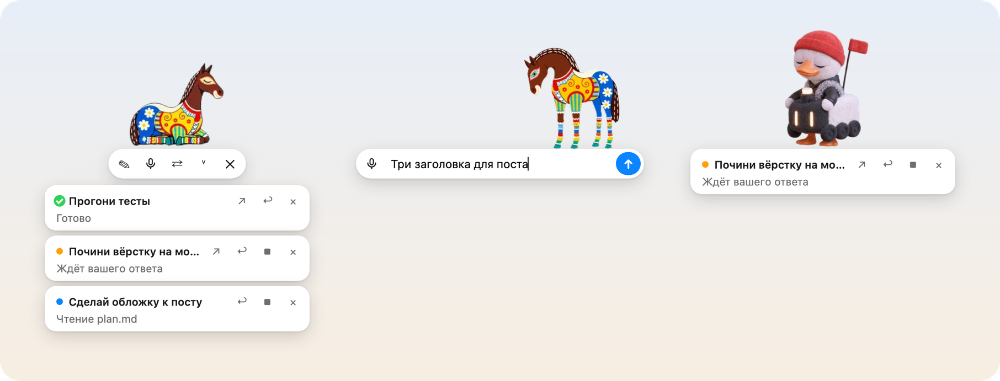

<div align="center">


# Claude Pet

**A little pet at the bottom of your Mac screen that shows what Claude Code is doing
and takes new tasks by text or voice.**

[](https://github.com/dondorno008-eng/claude-pet/releases/latest)


[](LICENSE)

[Русский](README.md) · English

</div>

---

Claude Code tasks take a while, and you don't want to stare at the window the whole time.
The pet sits on top of all windows and shows whether Claude is working, waiting for your
answer, done, or stuck on an error. You can also give it a task: it starts a new background
chat and leaves the one you're working in alone.

<p align="center">
  
</p>
<p align="center"><sub>Left to right: task cards · input bar · New Year Gusik waiting for your answer</sub></p>

> The interface is in Russian for now; the prompts you type can be in any language.

## Quick start

**1. Install.** Open Terminal and paste one line:

```bash
curl -fsSL https://raw.githubusercontent.com/dondorno008-eng/claude-pet/main/install.sh | bash
```

The script puts `HorsePet.app` into `~/Applications` and installs the `horse-pet` plugin
into Claude Code. You need macOS 12 or newer and Claude Code: the Claude app (Code tab)
or `claude` in the terminal.

**2. Open a new chat in Claude Code** or restart the Claude app. The horse appears at the
bottom of the screen and starts following your sessions.

**3. Pick a pet.** Hover over the horse and press **⇄** until you see the one you like.

**4. Give it a first task.** Press **✎** or just click the pet, type a prompt and press Enter.
A card appears under the pet showing what Claude is doing right now.

## Pick your character

There are five pets, and they all behave the same: they doze, run when you drag them,
peek at the input bar and listen to you through a red phone handset.

<table>
  <tr>
    <td align="center" width="20%"><br><b>Horse</b><br><sub>default</sub></td>
    <td align="center" width="20%"><br><b>Druzok</b><br><sub>delivery robot</sub></td>
    <td align="center" width="20%"><br><b>Druzok</b><br><sub>New Year</sub></td>
    <td align="center" width="20%"><br><b>Gusik</b><br><sub>cap and hoodie</sub></td>
    <td align="center" width="20%"><br><b>Gusik</b><br><sub>New Year</sub></td>
  </tr>
</table>

**To switch:** hover over the pet and press **⇄**. Each press moves to the next one:
Horse → Druzok → New Year Druzok → Gusik → New Year Gusik → back to Horse.
Your choice is remembered across restarts.

## What the pet shows

<table>
  <tr>
    <td align="center"><br><b>Working</b><br><sub>reading files, writing code,<br>running commands</sub></td>
    <td align="center"><br><b>Waiting</b><br><sub>needs your answer<br>or permission</sub></td>
    <td align="center"><br><b>Done</b><br><sub>task finished</sub></td>
    <td align="center"><br><b>Error</b><br><sub>something<br>went wrong</sub></td>
    <td align="center"><br><b>Listening</b><br><sub>you're dictating</sub></td>
  </tr>
</table>

When Claude is waiting, done or has failed, the card pops up on its own.

## How to use it

Hover over the pet to see the buttons **✎ 🎙 ⇄ ˅ ✕** and the task cards.

| What | How |
|---|---|
| **New task** | **✎** or a click on the pet opens the input bar. Enter sends, Esc closes. Every prompt becomes a **new chat** in the folder of the last active session (your home folder if there is none). It runs in the background with no window and doesn't touch your other chats. |
| **Voice** | **🎙** opens the input bar and starts listening. While the mic is orange, what you say is typed into the field. Click the mic again or press Esc to stop, Enter to send. The first time, macOS asks for microphone and speech recognition access. |
| **Task cards** | Each task gets a card with the prompt and what Claude is doing now. **↗** opens the chat in the Claude app, **↩** continues the same chat, **■** stops it, **×** dismisses the card. |
| **Move** | Drag the pet anywhere on the screen and it will run. |
| **Hide** | **✕** hides the pet. Bring it back with **⌃⌥Space** (Control+Option+Space) or `/horse` in Claude Code. The same shortcut hides it again. |

## If a new chat doesn't start

New chats are started by Claude Code **in the terminal** (`claude --bg`), which has its own
sign-in, separate from the Claude app. The installer checks it, and the card tells you what's
wrong if it turns grey or red. Usually one command is enough:

```bash
claude auth login
```

Sign in with the same account as in the Claude app and send the prompt again.

## Uninstall

```bash
curl -fsSL https://raw.githubusercontent.com/dondorno008-eng/claude-pet/main/install.sh | bash -s -- --uninstall
```

## How it works

The plugin (`plugin/`) writes each session's state to `~/.claude-pet/sessions/` and once a
second picks up the prompt the pet left in `~/.claude-pet/inbox/`. The window (`overlay/`,
Tauri) only reads and writes these files: no network, no ports. The format is in
[docs/protocol.md](docs/protocol.md).

The app isn't signed by Apple. Installing with `curl` doesn't quarantine the file, so macOS
runs it; an archive downloaded in a browser may be silently blocked, so use the command above.

The plugin alone, without the script:

```bash
claude plugin marketplace add dondorno008-eng/claude-pet
```

```bash
claude plugin install horse-pet@claude-pet
```

## License

[MIT](LICENSE)
