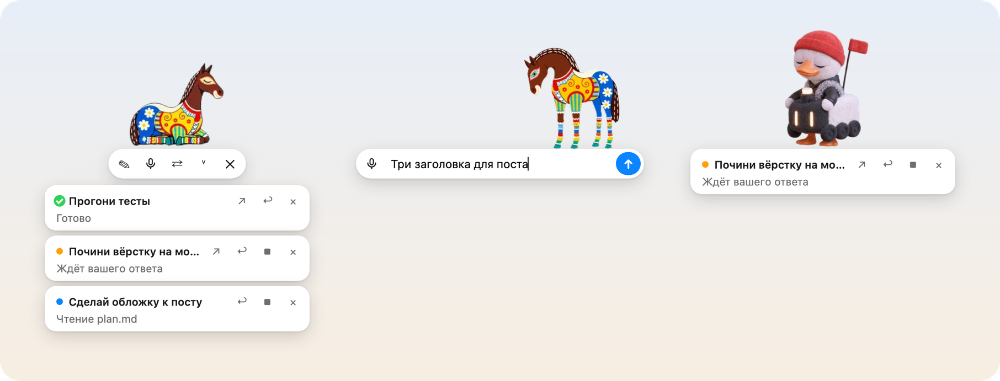
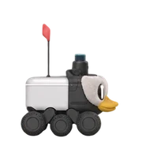
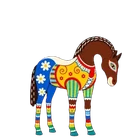
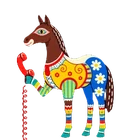

<div align="center">


# Лошадка для Claude Code

**Питомец внизу экрана Mac, который показывает, чем занят Claude Code,
и принимает новые задачи текстом или голосом.**

[](https://github.com/dondorno008-eng/claude-pet/releases/latest)


[](LICENSE)

Русский · [English](README.en.md)

</div>

---

Claude Code работает долго, а смотреть в окно всё время не хочется. Лошадка сидит
поверх всех окон. По ней видно, что Claude сейчас делает, ждёт вашего ответа, уже
закончил или споткнулся. Задачу можно дать прямо ей: она откроет новый фоновый чат
и не тронет тот, в котором вы работаете.

<p align="center">
  
</p>
<p align="center"><sub>Слева направо: карточки задач · строка ввода · Гусик новогодний ждёт вашего ответа</sub></p>

## Быстрый старт

**1. Установите.** Откройте «Терминал» и вставьте одну строку:

```bash
curl -fsSL https://raw.githubusercontent.com/dondorno008-eng/claude-pet/main/install.sh | bash
```

Скрипт положит приложение `HorsePet.app` в `~/Applications` и поставит мод `horse-pet`
в Claude Code. Нужны macOS 12 или новее и Claude Code: приложение Claude (вкладка Code)
или `claude` в терминале.

**2. Откройте новый чат в Claude Code** или перезапустите приложение Claude. Лошадка
появится внизу экрана и начнёт следить за сессиями.

**3. Выберите питомца.** Наведите на лошадку и нажимайте **⇄**, пока не появится тот,
кто вам нравится (подробнее ниже).

**4. Дайте первую задачу.** Нажмите **✎** или просто кликните по питомцу, напишите
запрос и нажмите Enter. Под питомцем появится карточка: что Claude делает прямо сейчас.

## Выберите персонажа

Питомцев пятеро, ведут себя все одинаково: дремлют, бегут, когда их тащат мышью,
заглядывают в строку ввода и слушают вас через красную трубку.

<table>
  <tr>
    <td align="center" width="20%"><br><b>Лошадка</b><br><sub>по умолчанию</sub></td>
    <td align="center" width="20%"><br><b>Дружок</b><br><sub>робот-курьер</sub></td>
    <td align="center" width="20%"><br><b>Дружок</b><br><sub>новогодний</sub></td>
    <td align="center" width="20%"><br><b>Гусик</b><br><sub>в кепке и худи</sub></td>
    <td align="center" width="20%"><br><b>Гусик</b><br><sub>новогодний</sub></td>
  </tr>
</table>

**Как сменить:** наведите на питомца и нажмите **⇄**. Каждое нажатие включает следующего
по кругу: Лошадка → Дружок → Дружок новогодний → Гусик → Гусик новогодний → снова Лошадка.
Выбор запоминается и сохраняется после перезапуска.

## Что показывает питомец

<table>
  <tr>
    <td align="center"><br><b>Работает</b><br><sub>Claude читает файлы,<br>пишет код, гоняет команды</sub></td>
    <td align="center"><br><b>Ждёт ответа</b><br><sub>нужен ваш ответ<br>или разрешение</sub></td>
    <td align="center"><br><b>Готово</b><br><sub>задача закончена</sub></td>
    <td align="center"><br><b>Ошибка</b><br><sub>что-то пошло<br>не так</sub></td>
    <td align="center"><br><b>Слушает</b><br><sub>вы диктуете<br>голосом</sub></td>
  </tr>
</table>

Когда Claude ждёт ответа, закончил или упал с ошибкой, карточка появляется сама,
даже если вы не наводили мышь.

## Как пользоваться

Наведите на питомца: появятся кнопки **✎ 🎙 ⇄ ˅ ✕** и карточки задач.

| Что | Как |
|---|---|
| **Новая задача** | **✎** или клик по питомцу открывает строку ввода. Enter отправляет, Esc закрывает. Каждый запрос становится **новым чатом** в папке последней активной сессии (если сессий нет, в домашней). Он работает в фоне, без окна, и старые чаты не трогает. |
| **Голосом** | **🎙** сразу открывает строку и слушает. Пока микрофон горит оранжевым, сказанное печатается в поле. Ещё раз на микрофон или Esc останавливает запись, Enter отправляет. В первый раз macOS спросит доступ к микрофону и распознаванию речи. |
| **Карточки задач** | Под питомцем видно запрос и то, что Claude делает сейчас: «Чтение plan.md», «Выполняет команду…», «Ждёт вашего ответа». У каждой задачи своя карточка. **↗** открывает чат в приложении Claude, **↩** дописывает в этот же чат, **■** останавливает, **×** убирает карточку. |
| **Переставить** | Питомца можно перетащить мышью в любое место экрана, и он побежит. |
| **Спрятать** | **✕** прячет питомца. Вернуть можно сочетанием **⌃⌥Пробел** (Control+Option+Space) или командой `/horse` в Claude Code. То же сочетание прячет его снова. |

## Если новый чат не запускается

Новые чаты из питомца запускает Claude Code **в терминале** (`claude --bg`). У него свой вход
в аккаунт, отдельный от приложения Claude. Установщик проверяет вход и сам его открывает. Если
карточка всё равно серая или красная, она подскажет причину. Чаще всего хватает одной команды:

```bash
claude auth login
```

Войдите тем же аккаунтом, что и в приложении Claude, и отправьте запрос ещё раз.
Если `claude` не находится, откройте приложение Claude хотя бы раз и повторите установку.

## Удаление

```bash
curl -fsSL https://raw.githubusercontent.com/dondorno008-eng/claude-pet/main/install.sh | bash -s -- --uninstall
```

## Как это устроено

Мод (`plugin/`) пишет состояние каждой сессии в `~/.claude-pet/sessions/` и раз в
секунду забирает промпт, который питомец положил в `~/.claude-pet/inbox/`. Окно
(`overlay/`, Tauri) только читает и пишет эти файлы: ни сети, ни портов.
Формат описан в [docs/protocol.md](docs/protocol.md).

Приложение не подписано Apple. Установка через `curl` не ставит на файл карантин,
поэтому macOS его запускает. Архив, скачанный браузером, macOS может молча заблокировать,
так что ставьте командой выше.

Мод можно поставить и отдельно, без скрипта:

```bash
claude plugin marketplace add dondorno008-eng/claude-pet
```

```bash
claude plugin install horse-pet@claude-pet
```

Картинки для этой страницы собираются из спрайтов питомцев: `python3 docs/media/make_media.py`.

## Лицензия

[MIT](LICENSE)
